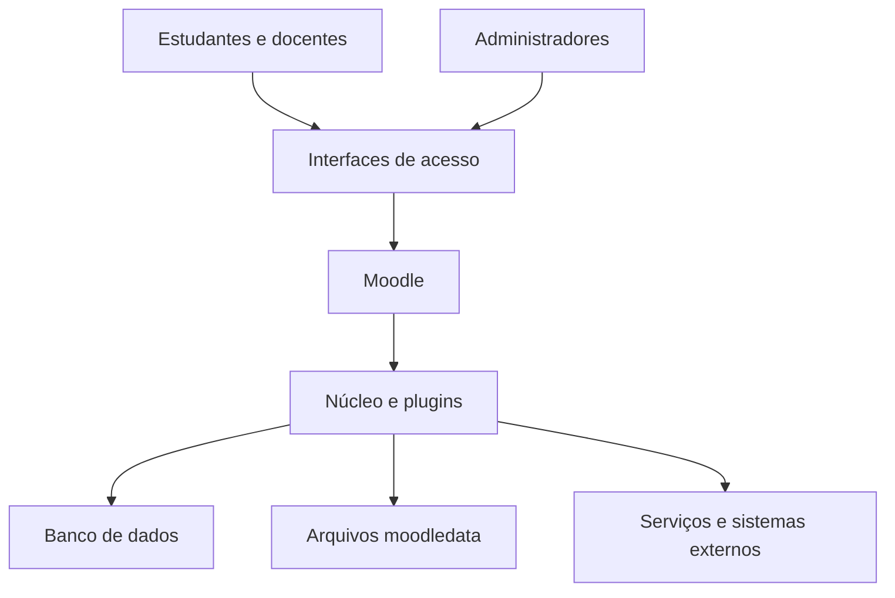
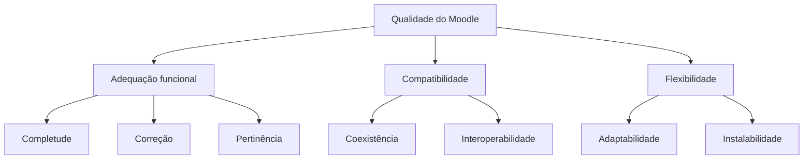

# Avaliação da Qualidade do Moodle

## Fase 1 — Estabelecimento dos Requisitos de Avaliação

**Grupo:** Marlyn Wescoff  
**Instituição:** Universidade de Brasília — Faculdade do Gama  
**Curso:** Engenharia de Software  
**Disciplina:** FGA0315 — Qualidade de Software 1  
**Período:** 2º/2026  
**Docente:** Profa. Cristiane Soares Ramos  
**Versão:** 1.0  
**Última atualização:** 19/10/2026  

**Integrantes:** Bernardo Broetto Brun
                 Pedro Rocha
                 Cadu Motta
                 João Pedro Maciel
                 Maykson Soares

## Resumo

Este relatório documenta a Fase 1 do processo de avaliação de produto de software da série SQuaRE aplicada ao Moodle, um sistema de gestão da aprendizagem de código aberto.

São definidos o propósito e o uso pretendido da avaliação, o requisitante e as partes interessadas, o tipo de produto e sua descrição estrutural, o modelo de qualidade adaptado, as características priorizadas, o escopo e a profundidade da avaliação e a relação com os Objetivos de Desenvolvimento Sustentável.

O modelo adotado utiliza como referência a ISO/IEC 25010:2023. As características selecionadas são adequação funcional, compatibilidade e flexibilidade. A priorização utiliza uma matriz de decisão ponderada, com filtro de viabilidade e análise de sensibilidade.

## Sumário

1. [Introdução](#1-introdução)
2. [Propósito da avaliação e uso pretendido](#2-propósito-da-avaliação-e-uso-pretendido)
3. [Requisitante e partes interessadas](#3-requisitante-e-partes-interessadas)
4. [Produto avaliado](#4-produto-avaliado)
5. [Modelo de qualidade](#5-modelo-de-qualidade)
6. [Seleção e priorização das características](#6-seleção-e-priorização-das-características)
7. [Escopo e profundidade da avaliação](#7-escopo-e-profundidade-da-avaliação)
8. [Objetivos de Desenvolvimento Sustentável](#8-objetivos-de-desenvolvimento-sustentável)
9. [Considerações finais e próximos passos](#9-considerações-finais-e-próximos-passos)
10. [Uso de inteligência artificial](#10-uso-de-inteligência-artificial)
11. [Repositório e rastreabilidade](#11-repositório-e-rastreabilidade)
12. [Referências](#12-referências)

## 1 Introdução

O Moodle é uma plataforma de gestão da aprendizagem de código aberto utilizada para organizar cursos, disponibilizar conteúdos, receber atividades, aplicar avaliações e acompanhar o desempenho dos estudantes.

Sua utilização envolve diferentes públicos, como estudantes, docentes, tutores, administradores e equipes de suporte. Esses públicos possuem necessidades distintas, que influenciam os requisitos e os critérios de qualidade do produto.

Este relatório apresenta a Fase 1 da avaliação, correspondente ao estabelecimento dos requisitos de avaliação. O trabalho organiza o propósito, o contexto de aplicação, as partes interessadas, o modelo de qualidade e os limites do estudo.

O objeto proposto é uma instalação local e controlada do Moodle. A avaliação abrange tarefas acadêmicas e aspectos de integração e adaptação do produto, sem representar uma auditoria de uma instalação institucional em produção.

## 2 Propósito da avaliação e uso pretendido

### 2.1 Por que avaliar

A manutenção de um ambiente Moodle envolve decisões sobre adoção de versões, atualização, integração com outros sistemas e preservação das funções acadêmicas essenciais.

A avaliação pretende produzir evidências que apoiem essas decisões, identificando quais funções são atendidas pelo produto, como ele troca informações com outros sistemas e como se adapta aos ambientes definidos para o estudo.

O propósito acadêmico é aplicar os conceitos de avaliação da qualidade de produto de software previstos na disciplina.

### 2.2 Cenário de aplicação

O cenário considera uma instituição de ensino superior que mantém uma instalação Moodle e analisa a adoção ou atualização para a versão 5.3 LTS.

A equipe utiliza sua experiência com o ambiente acadêmico como referência de contexto, sem afirmar que uma instituição específica tenha solicitado esta avaliação.

A versão-alvo é o Moodle 5.3 LTS. Caso sua instalação não seja viável com os recursos disponíveis, a equipe poderá adotar a versão 4.5 LTS, registrando a mudança e revisando os requisitos e procedimentos afetados.

### 2.3 Decisões apoiadas

**Tabela 1 — Decisões apoiadas pela avaliação**

| ID | Decisão | Responsável pela decisão | Característica relacionada |
|---|---|---|---|
| D1 | Avaliar a cobertura das tarefas essenciais de ensino pelo núcleo do Moodle, sem extensões de terceiros | Gestão acadêmica e equipe de TI | Adequação funcional |
| D2 | Priorizar integrações e testes de regressão após atualizações | Administradores de TI e integradores | Compatibilidade |
| D3 | Definir ambientes e procedimentos de instalação e atualização | Administradores de TI | Flexibilidade |
| D4 | Selecionar a ação de melhoria prevista nas próximas entregas | Equipe avaliadora e docente | Todas as selecionadas |

*Fonte: elaboração própria.*

As decisões da Tabela 1 orientam a seleção das características e dos objetos de avaliação.

## 3 Requisitante e partes interessadas

O requisitante formal é a docente da disciplina, responsável pelas regras e pelos critérios acadêmicos da avaliação.

No cenário de aplicação, a gestão acadêmica representa a parte interessada nas decisões de adoção e atualização do ambiente.

As necessidades apresentadas na Tabela 2 foram derivadas da documentação do produto, do contexto da disciplina e da experiência da equipe. Não foram realizadas entrevistas formais nesta fase; portanto, as necessidades dos demais grupos são hipóteses a validar.

**Tabela 2 — Partes interessadas, necessidades e influência**

| Parte interessada | Papel | Necessidade e critério de sucesso | Influência na avaliação |
|---|---|---|---|
| Docente da disciplina | Requisitante formal | Avaliação rastreável, reproduzível e coerente com a atividade | Define entregas e restringe a seleção de características |
| Gestão acadêmica | Decisora no cenário | Cobertura das funções essenciais e redução de riscos na adoção | Prioriza adequação funcional |
| Administradores de TI | Operadores | Instalar, atualizar e integrar o ambiente de forma controlada | Orientam compatibilidade e flexibilidade |
| Docentes e tutores | Usuários | Criar atividades, avaliar e consultar resultados corretos | Orientam completude e correção funcional |
| Estudantes | Usuários finais | Acessar conteúdos, entregar atividades e acompanhar notas | Orientam os fluxos essenciais e a adaptação a dispositivos |
| Comunidade mantenedora | Fornecedora e desenvolvedora | Receber relatos fundamentados e reproduzíveis | Fornece documentação e referências técnicas |
| Desenvolvedores de plugins e integradores | Terceiros | Utilizar interfaces documentadas para troca de informações | Orientam interoperabilidade |
| Grupo Marlyn Wescoff | Equipe avaliadora | Executar o estudo dentro dos recursos e prazos disponíveis | Delimita a viabilidade e a profundidade |

*Fonte: elaboração própria.*

## 4 Produto avaliado

### 4.1 Tipo de produto

O Moodle é um produto de software de código aberto distribuído sob licença GPL. Trata-se de uma aplicação web do tipo Learning Management System — LMS.

O objeto principal será o núcleo do Moodle, com tema padrão e sem plugins de terceiros. Recursos distribuídos com o produto poderão ser utilizados conforme a configuração definida para a avaliação.

### 4.2 Descrição estruturada

Uma instalação do Moodle envolve:

- Código da aplicação, executado em um ambiente PHP com servidor web.
- Banco de dados.
- Repositório de arquivos da instalação, denominado `moodledata`.
- Configurações de autenticação, permissões e atividades.
- Execução de tarefas agendadas, quando necessária.

O produto organiza cursos, usuários, matrículas, papéis e permissões. Sua arquitetura também utiliza plugins para atividades, recursos, temas, autenticação, matrícula e outras extensões.

### 4.3 Interfaces

As interfaces relevantes para o estudo são:

- Navegador web.
- Serviços web utilizados por integrações autorizadas.
- Importação e exportação de dados.
- Recursos de integração com ferramentas externas.
- Procedimentos de instalação e atualização.

O aplicativo móvel não será avaliado integralmente. Sua relação com o produto será considerada apenas quando houver teste específico dos serviços web utilizados para conexão.

### 4.4 Contexto e arquitetura

**Figura 1 — Contexto e arquitetura simplificada do Moodle.**  
*Fonte: elaboração própria a partir da documentação do produto.*

### 4.5 Dependências e restrições

Os requisitos de PHP, banco de dados e extensões deverão ser confirmados na documentação da versão efetivamente instalada.

Antes da execução, a equipe deverá registrar:

| Informação | Registro |
|---|---|
| Versão do Moodle | [Preencher] |
| Sistema operacional | [Preencher] |
| Servidor web | [Preencher] |
| Versão do PHP | [Preencher] |
| Banco de dados e versão | [Preencher] |
| Tema | [Preencher] |
| Recursos e plugins habilitados | [Preencher] |
| Forma de instalação | [Preencher] |

A avaliação não utilizará dados acadêmicos reais.

### 4.6 Implicações para a avaliação

**Tabela 3 — Possibilidades e limites de medição**

| Pode ser avaliado no ambiente controlado | Não será demonstrado por esta avaliação |
|---|---|
| Execução de tarefas essenciais do núcleo | Comportamento sob milhares de acessos simultâneos |
| Troca de dados por interfaces selecionadas | Integração com sistemas institucionais reais |
| Instalação e atualização nos ambientes definidos | Compatibilidade com todos os plugins disponíveis |
| Adaptação a navegadores e dispositivos selecionados | Uso contínuo durante um semestre letivo |
| Resultados de operações com dados fictícios | Conformidade jurídica ou auditoria integral de proteção de dados |

*Fonte: elaboração própria.*

## 5 Modelo de qualidade

### 5.1 Modelo adotado

Adota-se o modelo de qualidade de produto da ISO/IEC 25010:2023 como referência.

As características selecionadas são:

1. **Adequação funcional**, relacionada à cobertura e à correção das funções.
2. **Compatibilidade**, relacionada à coexistência e à troca de informações.
3. **Flexibilidade**, relacionada à adaptação e à instalação em ambientes definidos.

A capacidade de interação não integra a seleção em razão da restrição da atividade quanto à usabilidade.

### 5.2 Adaptação ao Moodle

O modelo foi adaptado ao contexto do estudo mediante:

- Interpretação das subcaracterísticas para um sistema de gestão da aprendizagem.
- Seleção de objetos que possam ser avaliados em ambiente local.
- Restrição da quantidade de ambientes e integrações.
- Exclusão de avaliações que não serão aprofundadas no prazo disponível.

**Tabela 4 — Subcaracterísticas e interpretação no Moodle**

| Característica | Subcaracterística | Interpretação no projeto | Situação |
|---|---|---|---|
| Adequação funcional | Completude funcional | Cobertura das tarefas essenciais selecionadas | Dentro |
| Adequação funcional | Correção funcional | Resultados corretos para notas, prazos e regras configuradas | Dentro |
| Adequação funcional | Pertinência funcional | Funções que apoiam a conclusão das tarefas propostas | Dentro |
| Compatibilidade | Coexistência | Operação em ambiente compartilhado definido, sem interferência funcional identificada nos testes | Dentro, com recorte |
| Compatibilidade | Interoperabilidade | Troca e uso de informações por interfaces e formatos selecionados | Dentro |
| Flexibilidade | Adaptabilidade | Execução das tarefas nos navegadores e dispositivos definidos | Dentro |
| Flexibilidade | Instalabilidade | Instalação e atualização com resultado verificável | Dentro |
| Flexibilidade | Substituibilidade | Substituição de outro produto para a mesma finalidade | Fora |
| Flexibilidade | Escalabilidade | Adaptação da capacidade diante de mudanças de carga | Fora |

*Fonte: elaboração própria a partir do modelo de referência.*

Backup e restauração poderão apoiar procedimentos de migração, mas não serão considerados, isoladamente, evidência de substituibilidade.

### 5.3 Representação gráfica

**Figura 2 — Modelo de qualidade adaptado ao projeto.**  
*Fonte: elaboração própria.*

## 6 Seleção e priorização das características

### 6.1 Método

A seleção utiliza quatro etapas:

1. Considerar as características do modelo, exceto capacidade de interação.
2. Aplicar um filtro de viabilidade e relevância.
3. Calcular a pontuação por matriz ponderada.
4. Comparar os resultados em cenários alternativos de pesos.

As notas variam de 1 a 5 e representam julgamentos iniciais da equipe.

Os critérios são:

- **R:** relevância para as partes interessadas.
- **K:** risco ou impacto de uma falha.
- **V:** viabilidade de medição.
- **A:** alinhamento às decisões D1 a D4.

Uma característica é elegível quando apresenta:

- Viabilidade igual ou superior a 3.
- Relevância igual ou superior a 2.

### 6.2 Pesos

**Tabela 5 — Pesos dos critérios por cenário**

| Critério | Base | Viabilidade maior | Relevância maior |
|---|---:|---:|---:|
| Relevância | 0,35 | 0,25 | 0,50 |
| Risco e impacto | 0,25 | 0,20 | 0,20 |
| Viabilidade | 0,25 | 0,40 | 0,15 |
| Alinhamento | 0,15 | 0,15 | 0,15 |
| **Total** | **1,00** | **1,00** | **1,00** |

*Fonte: elaboração própria.*

No cenário Base:

**Pontuação = 0,35R + 0,25K + 0,25V + 0,15A**

### 6.3 Resultados da priorização

**Tabela 6 — Notas, pontuações e elegibilidade**

| Característica | R | K | V | A | Base | Viabilidade maior | Relevância maior | Elegível |
|---|---:|---:|---:|---:|---:|---:|---:|---|
| Adequação funcional | 5 | 5 | 5 | 5 | 5,00 | 5,00 | 5,00 | Sim |
| Compatibilidade | 4 | 4 | 4 | 5 | 4,15 | 4,15 | 4,15 | Sim |
| Segurança da informação | 5 | 5 | 2 | 3 | 3,95 | 3,50 | 4,25 | Não |
| Flexibilidade | 4 | 3 | 4 | 4 | 3,75 | 3,80 | 3,80 | Sim |
| Eficiência de desempenho | 4 | 4 | 2 | 3 | 3,35 | 3,05 | 3,55 | Não |
| Confiabilidade | 4 | 4 | 2 | 3 | 3,35 | 3,05 | 3,55 | Não |
| Manutenibilidade | 3 | 3 | 4 | 3 | 3,25 | 3,40 | 3,15 | Sim |
| Segurança operacional | 1 | 1 | 1 | 1 | 1,00 | 1,00 | 1,00 | Não |

*Fonte: elaboração própria.*

Entre as características elegíveis, a ordem se mantém nos três cenários:

1. Adequação funcional.
2. Compatibilidade.
3. Flexibilidade.
4. Manutenibilidade.

Foram selecionadas as três primeiras.

### 6.4 Justificativas e trade-offs

A adequação funcional recebe prioridade por sua relação direta com tarefas acadêmicas e resultados esperados.

A compatibilidade é relevante para a troca de informações e para a integração do ambiente com ferramentas e formatos selecionados.

A flexibilidade atende às necessidades de instalação, atualização e adaptação a ambientes de acesso.

Segurança da informação, eficiência de desempenho e confiabilidade são relevantes, mas não serão aprofundadas neste projeto em razão do prazo e dos recursos destinados ao recorte escolhido. Essa decisão não significa que avaliações parciais dessas características sejam impossíveis.

A manutenibilidade permaneceu elegível, mas não foi selecionada para preservar a profundidade das três características prioritárias.

A análise de sensibilidade também evidencia uma limitação: a segurança da informação teria posição elevada sem o filtro de viabilidade. Portanto, o resultado depende desse filtro, e a característica é uma candidata para trabalho futuro.

### 6.5 Relação a investigar

A adoção de plugins pode ampliar a cobertura funcional e, ao mesmo tempo, aumentar a complexidade de integração e atualização.

Essa relação é uma hipótese para estudos posteriores. O escopo principal não permitirá concluir sobre plugins de terceiros em geral.

## 7 Escopo e profundidade da avaliação

### 7.1 Objetos

Os objetos propostos são:

- Núcleo do Moodle na versão definida.
- Tema padrão.
- Tarefas acadêmicas selecionadas.
- Interfaces de integração selecionadas.
- Procedimentos de instalação e atualização.
- Documentação oficial utilizada como referência de requisitos.

### 7.2 Profundidade

A avaliação será predominantemente de caixa preta, orientada a tarefas.

Serão observadas entradas, saídas, estados e resultados das operações. O código-fonte poderá ser consultado para esclarecer comportamentos, sem caracterizar uma auditoria de código.

As fases seguintes deverão detalhar os dados de teste, ambientes, ferramentas, métricas e critérios de julgamento.

### 7.3 Delimitação

**Tabela 7 — Escopo e justificativas**

| Item | Situação | Justificativa |
|---|---|---|
| Núcleo do Moodle | Dentro | Representa a base comum do produto |
| Tarefas, questionários, fórum e notas | Dentro | Correspondem a funções acadêmicas essenciais |
| Serviços web e formatos selecionados | Dentro | Permitem avaliar interoperabilidade com recorte controlado |
| Navegadores e dispositivos selecionados | Dentro | Permitem avaliar adaptação dos fluxos |
| Instalação e atualização | Dentro | Relacionadas à decisão D3 |
| Aplicativo móvel | Parcial | Considerar apenas conexões previstas no roteiro |
| Plugins de terceiros | Fora | Amplitude e heterogeneidade incompatíveis com o prazo |
| Instalação institucional em produção | Fora | O objeto será uma instância local controlada |
| Capacidade de interação | Fora | Restrição da atividade |
| Segurança, desempenho, confiabilidade e manutenibilidade | Fora do aprofundamento | Priorização e recursos do projeto |
| Escalabilidade | Fora | Não será preparado um estudo específico de variação de carga |
| Substituibilidade | Fora | Não há cenário de substituição entre produtos definido |

*Fonte: elaboração própria.*

### 7.4 Limites de validade

Os resultados valerão para a versão, a configuração e os ambientes efetivamente testados.

Não serão generalizados para todas as instalações do Moodle, todos os dispositivos ou todos os plugins.

A avaliação não demonstrará estabilidade de longo prazo, resistência a ataques ou capacidade de atender grandes populações simultâneas.

Uma mudança da versão-alvo exigirá revisão das dependências, dos procedimentos e das conclusões afetadas.

## 8 Objetivos de Desenvolvimento Sustentável

O vínculo principal é com o **ODS 4 — Educação de qualidade**.

A avaliação considera as metas:

- **4.3:** igualdade de acesso à educação técnica, profissional e superior de qualidade.
- **4.4:** desenvolvimento de habilidades relevantes, inclusive técnicas e profissionais.
- **4.5:** redução de disparidades e garantia de acesso à educação para grupos vulneráveis.

Os indicadores oficiais não serão calculados pelo projeto. Serão utilizados indicadores locais relacionados às barreiras técnicas e às capacidades do ambiente.

**Tabela 8 — Relação entre ODS e avaliação**

| Meta | Relação com o Moodle | Indicador local proposto |
|---|---|---|
| 4.3 | Oferta de funções para participação em atividades educacionais | Proporção de tarefas essenciais atendidas pelo núcleo |
| 4.3 | Possibilidade de implantação nos ambientes definidos | Proporção de instalações concluídas com êxito |
| 4.4 | Suporte ao uso de conteúdos e ferramentas de formação | Proporção de cenários de interoperabilidade concluídos |
| 4.5 | Acesso por diferentes dispositivos e navegadores | Proporção de ambientes em que os fluxos essenciais são concluídos |

*Fonte: elaboração própria a partir das metas do ODS 4.*

A relação com a meta 4.4 é indireta: integrar conteúdos não demonstra aquisição de habilidades.

A relação com a meta 4.5 também é parcial. A adaptação a dispositivos pode reduzir barreiras técnicas, mas não comprova equidade de acesso nem acessibilidade para pessoas com deficiência.

Os resultados deverão ser apresentados como contribuições potenciais, sem afirmar cumprimento das metas globais.

## 9 Considerações finais e próximos passos

A Fase 1 definiu o propósito, as partes interessadas, o produto, o modelo adaptado, as características priorizadas e os limites da avaliação.

As próximas fases deverão:

1. Transformar as características selecionadas em objetivos GQM.
2. Derivar questões e métricas.
3. Definir critérios de julgamento.
4. Especificar ambientes, recursos e procedimentos.
5. Executar os testes.
6. Analisar as evidências.
7. Selecionar e justificar uma ação de melhoria.

Os principais riscos são:

- Dificuldade de preparação da versão-alvo.
- Dependências incompatíveis com os recursos disponíveis.
- Escopo de integração maior que a capacidade de execução.
- Necessidades das partes interessadas ainda não validadas.
- Diferenças entre o ambiente local e uma instalação institucional.

As limitações deverão acompanhar os resultados finais.

## 10 Uso de inteligência artificial

A elaboração deste documento contou com apoio de ferramentas de inteligência artificial:

- **Claude, da Anthropic:** apoio ao rascunho original, à organização das seções, aos diagramas e à proposta da matriz de decisão.
- **ChatGPT, da OpenAI:** apoio à revisão crítica e à adaptação do conteúdo para publicação no GitHub Pages.

A equipe deverá verificar as fontes, validar as notas atribuídas e confirmar se o escopo proposto corresponde ao trabalho que será executado.

**Responsáveis pela revisão humana:** [Preencher]  
**Data da revisão:** [Preencher]  
**Ajustes confirmados pela equipe:** [Preencher]

A declaração deverá ser atualizada para refletir apenas as ferramentas e atividades efetivamente utilizadas.

## 11 Repositório e rastreabilidade

| Recurso | Endereço |
|---|---|
| Repositório | [Inserir link] |
| GitHub Pages | [Inserir link] |
| Release da Fase 1 | [Inserir link] |
| Relatório em PDF | [Inserir link] |
| Memória de cálculo da matriz | [Inserir link, quando disponível] |
| Evidências das próximas fases | [Inserir link, quando disponíveis] |

A memória de cálculo deverá permitir reproduzir os valores da Tabela 6.

A página deverá ser atualizada a cada entrega, mantendo a correspondência entre relatório, release, métricas e evidências.

## 12 Referências

- **ISO/IEC.** ISO/IEC 25010:2023 — Systems and software engineering — Systems and software Quality Requirements and Evaluation — Product quality model. Disponível em: https://www.iso.org/standard/78176.html.

- **MOODLE.** Releases. Moodle Developer Resources. Disponível em: https://moodledev.io/general/releases. Acesso em: 19 out. 2026.

- **MOODLE.** Moodle 5.3. Moodle Developer Resources. Disponível em: https://moodledev.io/general/releases/5.3. Acesso em: 19 out. 2026.

- **MOODLE.** Moodle architecture. Disponível em: https://docs.moodle.org/dev/Moodle_architecture. Referência arquitetural; requisitos de instalação devem ser conferidos na documentação da versão utilizada.

- **HUNT, Tim.** Moodle. In: The Architecture of Open Source Applications, v. 2. Disponível em: https://aosabook.org/en/v2/moodle.html.

- **NAÇÕES UNIDAS BRASIL.** Objetivo de Desenvolvimento Sustentável 4 — Educação de qualidade. Disponível em: https://brasil.un.org/pt-br/sdgs/4.

- **RAMOS, Cristiane Soares.** Materiais da disciplina Qualidade de Software 1. Universidade de Brasília, 2026.

- **CRITERIOS FASE 1.pdf.** Rubrica de avaliação e revisão por pares fornecida na disciplina.

---

**Grupo Marlyn Wescoff — Qualidade de Software 1 — UnB**  
**Versão 1.0 — Atualizado em 19/10/2026**
